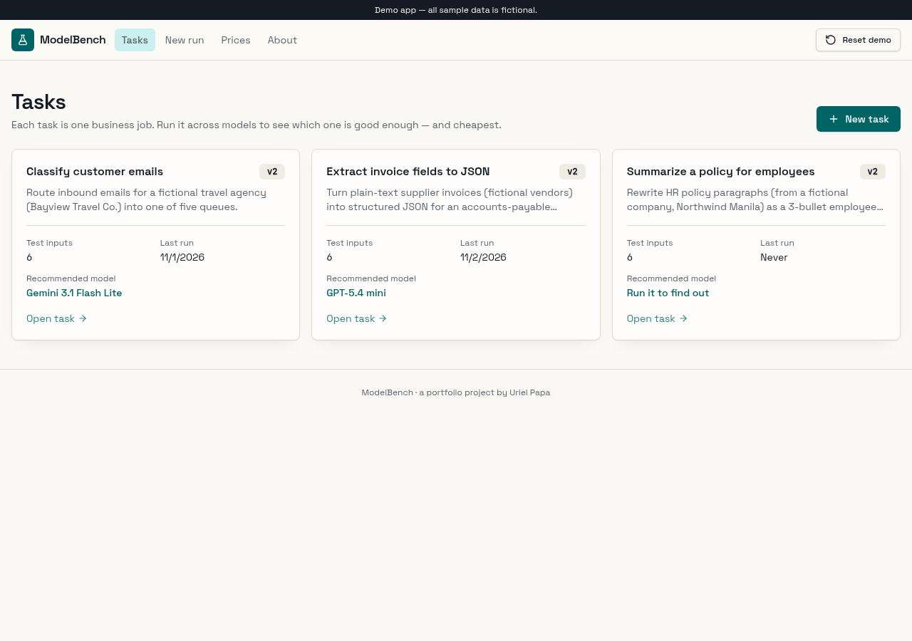
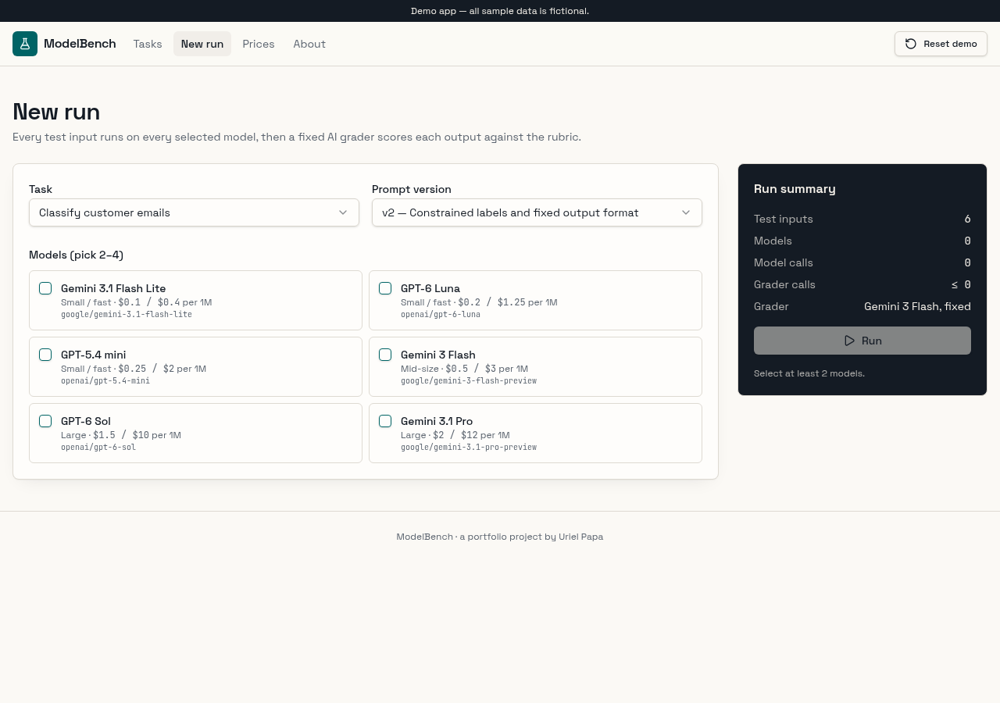
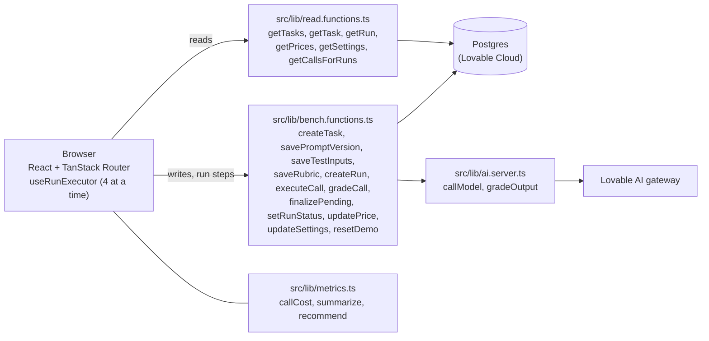

# ModelBench

Compare LLMs on cost, speed and quality for one business task, and get a recommendation for the cheapest model that is good enough.

**Live demo:** https://modelbench-uriel.lovable.app

Demo app. All sample data is fictional.



## The problem

Teams that add an LLM to a business process have to pick a model, and they usually ask "which one, and what will it cost?" The answer is often a guess, based on the largest model or a public leaderboard rather than their own task. Picking too large a model raises the per-request bill for every request. Picking too small a model gives wrong answers in production.

## What it does

- **Tasks**: each task is one business job (for example "Classify customer emails"). The list shows the number of test inputs, the latest prompt version, the last run date and the recommended model.
- **Task detail**: tabs for a versioned prompt (system prompt plus a user template with an `{{input}}` placeholder, saved as v1, v2, v3… with change notes), 5–20 test inputs with optional reference answers, a rubric with a 1–5 pass threshold, and run history.
- **New run**: pick a task, a prompt version and 2–4 models. Every test input runs on every model with live progress, then a fixed grader model scores each output.
- **Run results**: a per-model summary (average score, pass rate, average and p95 latency, tokens, run cost, projected cost per 1,000 runs), a quality-vs-cost scatter chart, recommendation cards (cheapest model meeting the pass-rate target, highest quality, fastest), a side-by-side output viewer per input, and an "All calls" table with per-call cost.
- **Prices**: an editable table of input and output prices per 1M tokens (USD), with a PHP rate and the pass-rate target. Every cost on every page recomputes from this table.
- **Reset demo**: restores the seed data (3 tasks and one completed sample run).
- **About this project**: problem, approach, architecture and next steps.




## How it works

The pattern is "run the same task on several models, then use an LLM as a judge". The browser drives a run one call at a time, with up to 4 calls in flight. Each call is a server function that sends the rendered prompt to the Lovable AI gateway (streamed chat completions) and stores the output, latency, token usage and status. If the response has no usage field, tokens are estimated as characters ÷ 4 and marked as estimated. After all calls finish, a fixed grader model (Gemini 3 Flash) scores each output 1–5 against the rubric and reference answer, with a one-line reason. Pass means score ≥ the task threshold.

Running one call per server request keeps each request short, so no single request hits a worker timeout. It also means a reloaded results page can resume a run. Calls that time out (60 s) or fail are stored as failed rows. Before a run is marked completed, any rows still pending are marked failed, so a run never gets stuck.

Costs are never stored. They are computed in the browser from stored token counts and the current Prices table.



## Data model

| Table | What it holds |
| --- | --- |
| `tasks` | Task name, description, rubric text and pass threshold (1–5). |
| `prompt_versions` | System prompt, user template, version number and change note per task. |
| `test_inputs` | Ordered test inputs per task, each with an optional reference answer. |
| `runs` | One row per run: task, prompt version, selected models, status. |
| `run_calls` | One row per input × model: output, error, latency, input/output tokens, estimated flag, status, grader score, reason and grade status. |
| `prices` | Model id, friendly name, size class, input and output USD price per 1M tokens. |
| `settings` | Single row: PHP exchange rate and pass-rate target. |

Seed data lives in the `public.reset_demo()` SQL function, which the Reset demo button calls.

Row Level Security is enabled on every table with no anonymous or authenticated access. All reads and writes go through server functions that use a server-side service client. This keeps the public demo safe without a login.

## Quality and testing

Browser QA on the published app:

- Runs execute every test input on 2–4 models, 4 calls at a time, with live progress. Each call records output, latency, input/output tokens and status. The grader scores each output 1–5 against the rubric.
- Cost formula: (input tokens × input price + output tokens × output price) ÷ 1,000,000. QA hand-checked one call: 108 × $1.50 + 104 × $10 per 1M = $0.00120, which matched the page.
- QA changed a model's price, and the run's costs updated to match a hand calculation.
- The seeded sample run on "Classify customer emails" recommends Gemini 3.1 Flash Lite (5 of 6 passed, 83%).
- A new 3-model run on "Extract invoice fields to JSON" completed 18 of 18 calls, all graded, in about 35 seconds.
- Saving a prompt edit creates v3, and v3 can be selected for a run.
- Fixed after QA: chart labels no longer clip or overlap the axis, grading progress counts up live, and broken task/run links show "not found" instead of an error.

Automated tests (Vitest, run with `npm test`):

- `src/test/metrics.test.ts`: cost is tokens × price per 1M; the recommendation picks the cheapest model meeting the 80% pass-rate target (and changes when the target is 81%); failed calls count against the pass rate.
- `src/test/app-routing.test.tsx`: the `/` path matches a page route instead of falling through to "not found".

## Tech stack

- **Frontend**: React 19, TanStack Router, TanStack Query, Tailwind CSS v4, shadcn/ui (Radix), Recharts, Sonner.
- **Server**: TanStack Start server functions (`createServerFn`), Zod input validation.
- **Database**: Postgres on Lovable Cloud, accessed with `@supabase/supabase-js`.
- **AI**: Lovable AI gateway (Gemini and GPT models, streamed chat completions).
- **Build and hosting**: Vite 7, deployed by Lovable on an edge worker runtime.

## Run locally

Prerequisites: Node 22.

```sh
npm i
npm run dev
```

Environment variables (names only, see `.env`):

- `SUPABASE_URL`, `SUPABASE_PUBLISHABLE_KEY`, `SUPABASE_PROJECT_ID`
- `VITE_SUPABASE_URL`, `VITE_SUPABASE_PUBLISHABLE_KEY`, `VITE_SUPABASE_PROJECT_ID`
- Server-only: a service role key for the database and `LOVABLE_API_KEY` for the AI gateway.

Note: AI calls use the Lovable AI gateway, which only works with Lovable Cloud. To run elsewhere, replace the calls in `src/lib/ai.server.ts` with your own model provider and key.

## Limitations and next steps

- Public demo with no login. A real deployment would add accounts, per-team workspaces and roles.
- Prices are example values entered by hand. A real deployment would sync them from the provider or a billing export.
- One LLM grader judges quality. A real deployment would calibrate it against human labels, add deterministic checks (for example JSON schema validation for extraction tasks) and repeat runs to measure variance.
- Runs are driven from the browser tab. A real deployment would use a server-side queue so long runs continue after the tab closes.
- Results cover a small test set (6 inputs per seeded task). Larger, representative test sets would give more reliable recommendations.

## Author

Uriel Papa — [GitHub](https://github.com/Edamuza) · [LinkedIn](https://www.linkedin.com/in/uriel-papa-vitese01/)

Built with Lovable (AI app builder) from a written spec, then tested against acceptance checks and fixed.
